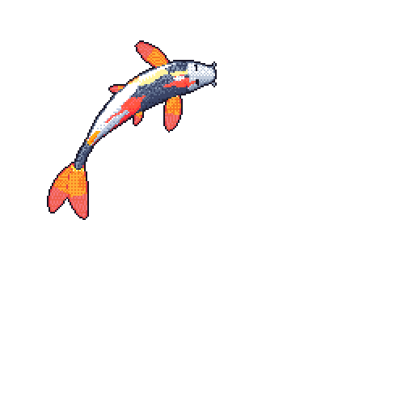

<!-- Title -->
<h1 align="center" title="...and I'm happy to see you here :)">𓆝 𓆟 Welcome to my Profile𓆞 𓆝 𓆟</h1>

<!-- Contact and keys -->

<!-- Socials -->

   <kbd>
  
    
  
  </kbd>

   
<!-- Outer collapsible -->  

   
<b>✶ Click to unravel more</b>

  
    
   
<!-- About Section -->

  
<b>👤 About</b>

    

      
      
<blockquote>

I build tools and the agents that use them — Para CLI, a personal grimoire of spells, and a small forest of AI personas. Most of my code is software with a bit of character.

I self-host what I can: a homelab, my own services, my own tools. If it can run on my machines instead of someone else's, it probably does.

When I'm not at the keyboard, I'm playing the piano, travelling, or getting my hands in the soil 🌱.

</blockquote>
    
----
  
  

  

<!-- Tech Stack -->  

  
<b>🛠️ Tech Stack</b>

    

| **Category** | **Technologies** |
| - | - |
**Core** |       
**Frontend** |   
**Cloud** |  
**DevOps** |   
**Data** |  
**Misc** | [&color=1793D1&logo=archlinux&logoColor=FFFFFF)](https://archlinux.org/) 
**Editors** |  

<i>The koi below is drawn nightly from my public GitHub activity — its markings wear the languages I actually code in, and it grows as I ship.</i>
      
 

----      

  

  

<!-- Koi -->

  

<a href="https://parastus.me">parastus.me 🌱</a>

<!--

  
<b>PGP</b>

    

 
  
  

